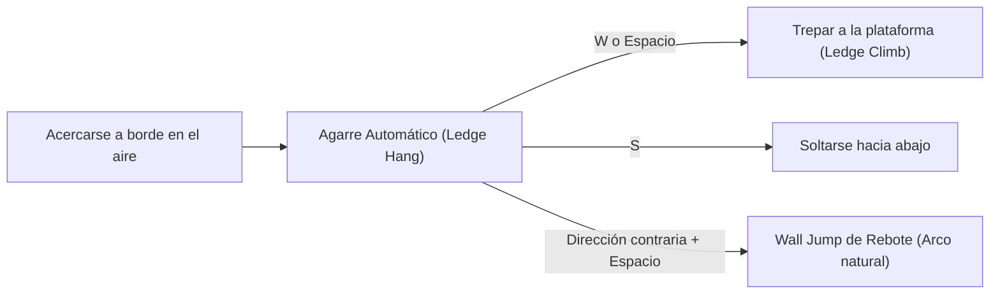
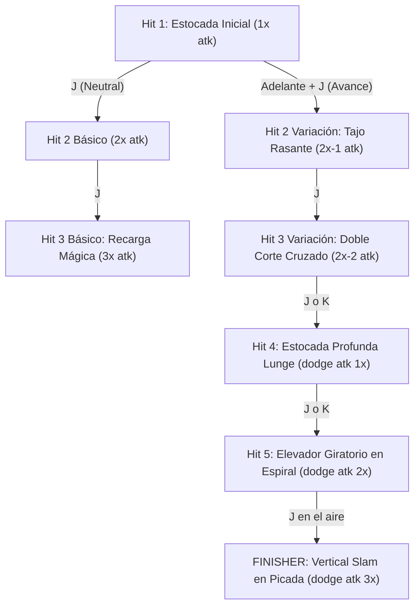

# 🎮 Manual de Juego: Controles, Movilidad y Sistema de Combate

Bienvenido al manual oficial de mecánicas y controles del proyecto. Este documento reúne todos los movimientos, técnicas de plataformeo, árboles de combos y reglas de supervivencia implementadas.

---

## 🕹️ 1. Tabla Rápida de Teclas

| Tecla / Comando | Acción Principal | Contexto |
| :--- | :--- | :--- |
| **`A` / `D`** *(o Flechas $\leftarrow / \rightarrow$)* | Caminar | Suelo |
| **`Shift Izquierdo`** | Correr (Sprint) | Suelo |
| **`Espacio`** | Salto de altura variable | Suelo |
| **`Espacio`** | Doble Salto | En el aire |
| **`S`** | Agacharse / Gatear | Suelo |
| **`K`** | Esquive frontal (Dodge) / Backdodge / Slide | Suelo |
| **`J`** | Ataque / Cadena de Combos | Suelo o Aire |
| **`W + J`** | Ataque Vertical Ascendente | Suelo o Aire |
| **`S + J`** *(o `J` tras elevación)* | Vertical Finisher Slam (Caída en picada) | Aire |
| **`H`** | Curar 25 HP (3 usos máx., 5s cooldown) | Cualquier momento |

---

## 🏃 2. Sistema de Locomoción y Plataformeo

### 2.1. Caminata y Sprint
* **Caminata (`A` / `D`):** Velocidad base de $2.3\text{ m/s}$. Brinda control milimétrico en plataformas estrechas.
* **Carrera / Sprint (`Shift`):** Aumenta la velocidad al doble ($4.6\text{ m/s}$). Activa un indicador dinámico en el HUD. Permite saltar abismos de hasta $8\text{ baldosas}$ ($2.56\text{ m}$).

### 2.2. Salto Dinámico (Estilo Celeste)
* **Altura Adaptativa:** Al mantener pulsado `Espacio`, el personaje alcanza su altura máxima de salto ($2.8\text{ baldosas} = 0.90\text{ m}$). Si se suelta la tecla durante el ascenso, la gravedad corta el impulso a la mitad permitiendo saltos cortos precisos.
* **Apex Hang Time:** En la cúspide del salto, la gravedad se reduce temporalmente ($0.4\times$) otorgando una ventana de flotabilidad para maniobrar en el aire.
* **Coyote Time & Jump Buffer:** Ventana de $0.15\text{ s}$ que perdona pulsar el salto milisegundos tarde al salir de una cornisa o milisegundos antes de aterrizar.
* **Doble Salto:** Al pulsar `Espacio` en el aire, se ejecuta un giro ágil que eleva al personaje nuevamente, alcanzando alturas combinadas de hasta $5.6\text{ baldosas}$ ($1.80\text{ m}$).

### 2.3. Agachado y Deslizamiento (Crouch & Slide)
* **Agacharse (`S`):** Reduce la altura del collider físico de $0.55\text{ m}$ a $0.32\text{ m}$, permitiendo cruzar túneles de $1$ bloque de altura.
* **Gateo (`S + A/D`):** Permite avanzar a paso cauteloso bajo techos bajos. Cuenta con sensor automático de techo (*Ceiling Check*) que impide levantarse hasta salir a espacio libre.
* **Deslizamiento / Slide (`K` durante carrera o `S + K`):** El personaje derrapa a $8.5\text{ m/s}$ sobre el suelo con fricción progresiva para cruzar pasajes estrechos a toda velocidad.

---

## 🧗 3. Salientes y Muros (Ledge Grab & Wall Jump)

* **Detección Automática:** Raycasts al pecho y sobre la cabeza detectan cualquier borde sólido. El personaje queda colgado de forma estable hasta un máximo de 3 segundos.
* **Subir (`W` o `Espacio`):** Reproduce animación de 8 frames y sitúa al personaje de pie sobre la superficie.
* **Wall Jump Lateral (`Dirección opuesta + Espacio`):** Impulsa al personaje hacia el lado contrario con $3.8\text{ m/s}$ horizontales y $6.8\text{ m/s}$ verticales, con protección de cooldown para evitar re-enganches indeseados en la misma esquina.

---

## ⚔️ 4. Sistema de Combate y Combos

### 4.1. Basic 3-Hit Combo (Cadena Terrestre Neutral)
* **Hit 1 (`prota_atk1.anim`):** Estocada frontal con leve avance ($1.2\text{ m/s}$).
* **Hit 2 Básico (`prota_atk2.anim`):** Corte horizontal medio para mantener a raya al oponente.
* **Hit 3 Básico (`prota_atk3.anim`):** Giro con recarga mágica de varita y ráfaga de impacto que empuja a los enemigos.

### 4.2. 5-Hit Combo Variation with Vertical Finisher (Cadena de Avance)
* **Hit 1 (`prota_atk1.anim`):** Apertura del combo con `J`.
* **Hit 2 Variación (`prota_atk2_1.anim`):** Manteniendo `A` o `D` (o corriendo), estocada rasante con impulso hacia adelante ($1.8\text{ m/s}$).
* **Hit 3 Variación (`prota_atk2_2.anim`):** Doble tajo continuo implacable ($2.2\text{ m/s}$).
* **Hit 4 Lunge (`prota_dodge_atk1.anim`):** Embestida frontal deslizante de largo alcance ($4.2\text{ m/s}$).
* **Hit 5 Elevador (`prota_dodge_atk2.anim`):** Giro ascendente en espiral que **lanza a la protagonista y al enemigo al aire** ($+7.8\text{ m/s}$).
* **Vertical Finisher Slam (`prota_vertical_atk.anim`):** Pulsar `J` en el aire tras elevarse desata una **caída en picada masiva a $-14.0\text{ m/s}$**, estrellando la espada contra el suelo con onda expansiva y daño crítico.

### 4.3. Técnicas Especiales y Cancelaciones
* **Cancelación Evasiva (`K`):** En cualquier momento de un combo terrestre, pulsar `K` cancela de inmediato la animación para deslizarse esquivando el ataque del enemigo.
* **Ataque Vertical (`W + J`):** Corte hacia arriba que propina elevación directa tanto en tierra como en el aire.
* **Ataque Aéreo en Salto (`J` en el aire):** Tajo horizontal amplio para abatir enemigos voladores.

---

## 💖 5. Salud, Curación y Condiciones de Derrota

| Mecánica | Valor / Regla | Comportamiento |
| :--- | :--- | :--- |
| **Vida Máxima** | $100\text{ HP}$ | Barra superior izquierda estilo juego de peleas. |
| **Curación (`H`)** | $+25\text{ HP}$ | Máximo **3 cargas** por vida. Cuenta con **cooldown de 5 segundos**. |
| **HUD de Curación** | Esquina inferior izquierda | Mano mágica con contador numérico y círculo de recarga. |
| **Caída al Vacío** | $-25\text{ HP}$ | Si caes al abismo, reapareces de inmediato en la última plataforma sólida. |
| **Muerte ($0\text{ HP}$)** | *HAS MUERTO* | Pantalla de Game Over estilo Dark Souls con desvanecimiento a negro y reinicio del nivel. |

---

## 💡 6. Consejos y Estrategias para Playtesters
1. **Contra el Burning Ghoul:** Golpéalo primero con la estocada (`J`); mientras mantengas el combo activo, el enemigo quedará aturdido (*hit-stun*) y no podrá contraatacar.
2. **Elevación Aérea:** El Golpe 5 de la variación es ideal para sacar a los enemigos de plataformas peligrosas y rematarlos con la caída en picada.
3. **Control del Salto:** Si necesitas aterrizar en bloques pequeños, suelta `Espacio` en cuanto inicies el salto para evitar saltar de más.
